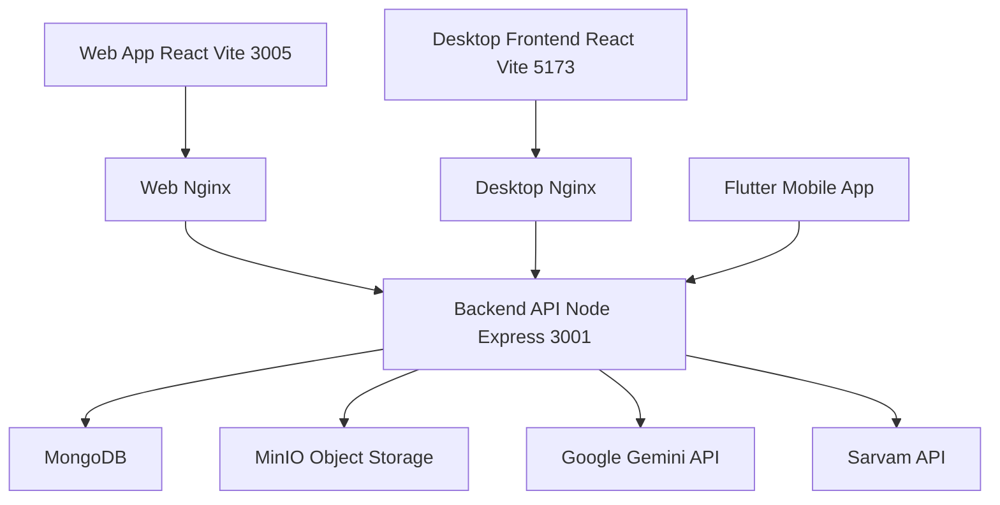
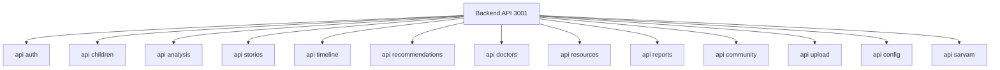
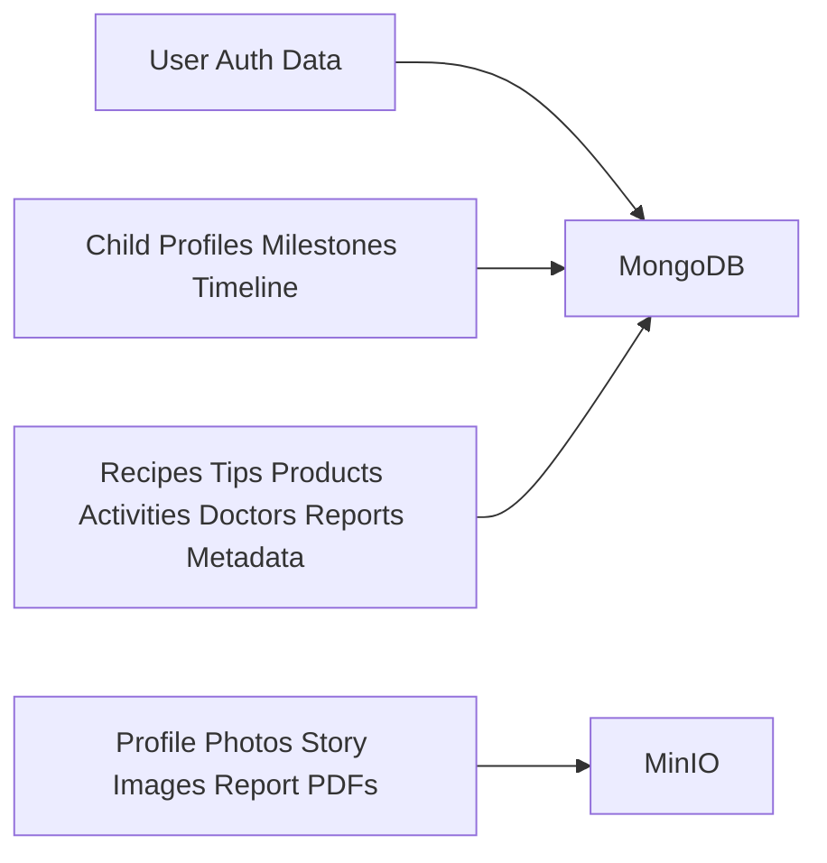

# Little Leap System Architecture

## Overview
Little Leap is currently a modular monolith backend with multiple clients and external integrations.

- Backend runtime: `Node.js + Express` (single API service)
- Primary database: `MongoDB`
- Object storage: `MinIO` (S3-compatible)
- AI integrations: `Google Gemini`, `Sarvam` (optional routes)
- Clients: React web app, React desktop frontend, Flutter mobile app

## Service Inventory

| Layer | Service | Port | Purpose |
|---|---|---:|---|
| Client | Web App (`tinysteps-ai`) | 3005 | Parent-facing web UI |
| Client | Desktop Frontend (`desktop-frontend`) | 5173 | Desktop-first web UI |
| Client | Flutter App (`tinysteps_flutter`) | n/a | Mobile app consuming API |
| API | Backend (`backend`) | 3001 | Auth, child profiles, analysis, stories, timeline, recommendations, reports, uploads |
| Data | MongoDB | 27017 | Persistent application data |
| Data | MinIO | 9010/9011 | Files: profile photos, story images, report PDFs |
| External | Gemini API | external | AI generation and analysis |
| External | Sarvam API | external | Translation/TTS endpoints |

## Microservice Reality

- **Microservices in backend**: `0`
- **Current architecture**: `1` backend API service (modular monolith)
- **Containerized runtime services in compose**: `5` (`backend`, `web`, `desktop-frontend`, `mongo`, `minio`)

## Runtime Topology

## Backend API Surface Map

## Data and Storage Boundaries

## Internal Backend Modules (Single Service)

| Module Group | Key Files | Responsibility |
|---|---|---|
| App bootstrap | `backend/src/index.js` | Middleware, route mounting, health check, startup |
| Routing layer | `backend/src/routes/*.js` | Route-level request handling |
| Models | `backend/src/models/*.js` | Mongo schemas/data modeling |
| Services | `backend/src/services/*.js` | AI, storage, migrations, domain logic |
| Middleware | `backend/src/middleware/*.js` | Auth, Gemini init, validation flow |
| Migrations/seed | `backend/src/migrations/*`, `backend/src/seeds/*` | Startup migration + optional realistic seed |

## Security and Ops Notes

- JWT-based authentication for API requests.
- CORS controlled by `WEB_APP_URL` and `MOBILE_APP_URL`.
- Rate limiting controlled by `RATE_LIMIT_WINDOW_MS` and `RATE_LIMIT_MAX`.
- Migrations run at backend startup via migration runner.
- MinIO is optional at startup, but upload/report media endpoints require it.
